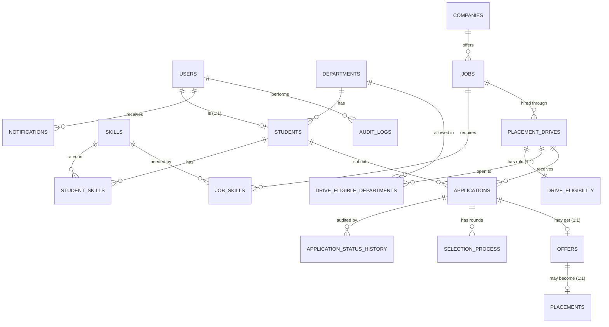

# Placement Cell Management Portal: ADBMS Documentation

*Advanced Database Management System project. Team: Suyash Jain (E293), Sarthak Jain (E320).*
*Database: PostgreSQL. Procedural language: PL/pgSQL. Application: React + Express (the database is the core; the application is the delivery layer).*

---

## 1. Why this is an ADBMS project, not a CRUD website

Every rule that protects the data lives **inside PostgreSQL**, so it holds no matter who writes to the database (the web application, pgAdmin, a script, a future service):

| Rule | Enforced by |
|---|---|
| A student applies once per drive | `UNIQUE (student_id, drive_id)` constraint |
| Only eligible students can apply, only to open drives | `check_student_eligibility()` + `validate_application_insert` trigger |
| Application status moves only along the legal lifecycle | `validate_application_status_change` trigger (state machine) |
| A failed interview round rejects the application | `reject_application_on_failed_round` trigger |
| An offer needs a selected candidate; one open offer per student | `validate_offer_insert` trigger + advisory lock |
| **One placement per student** across all drives | `validate_placement_insert` trigger + advisory lock |
| Sensitive changes are recorded with before/after values | `audit_row_change` trigger |
| The audit trail cannot be edited or deleted | `protect_audit_logs` trigger |
| Reports (placement rate, hiring, trends) | SQL functions and views, never calculated in the UI |

---

## 2. EER model



**Associative entities** (resolve many-to-many): `student_skills` (students and skills, with proficiency 1 to 5), `job_skills` (jobs and skills, with required level 1 to 5), `drive_eligible_departments` (drives and departments), and `applications` (students and drives; also a business record with its own lifecycle).

### Deviations from the original specification (all approved)

| # | Original design | Final design | Reason |
|---|---|---|---|
| 1 | No login entity | `users` table; `students.user_id` links to it | Authentication data is separate from profile data. Officers and admins need accounts but are not students |
| 2 | Eligibility not modelled | `drive_eligibility` + `drive_eligible_departments` | Eligibility becomes data the database can evaluate |
| 3 | `placements` held `student_id`, `company_id` and `offer_id` | `placements` holds only `offer_id` | Student and company are determined by the offer, so storing them is a transitive dependency (3NF violation). They are reached by joins and exposed through `placement_summary_view` |
| 4 | Skill requirements only on `Job_Skill` | Same; eligibility reads it | One place for skill requirements |
| 5 | Offer references Application | Same, plus `UNIQUE` | Enforces the 1:1 relationship |
| 6 | Text status columns | `CHECK (status IN (...))` | Invalid values are impossible |
| 7 | "PL/SQL" | **PL/pgSQL** | PostgreSQL's procedural language |
| + | `name` and `email` on `Student` | Moved to `users` | Officers and admins also need them; storing twice would break 3NF |
| + | `Proficiency_Level` (type unspecified) | `SMALLINT 1 to 5` | Comparable with `>=` in eligibility checks |
| + | `Package` | `*_lpa` NUMERIC(6,2) | The unit is explicit |
| + | New tables | `application_status_history`, `notifications`, `audit_logs` | Lifecycle audit, in-app notifications, activity trail |

---

## 3. Relational schema (18 designed tables, plus the session store)

`users`, `departments`, `students`, `skills`, `student_skills`, `companies`, `jobs`, `job_skills`, `placement_drives`, `drive_eligibility`, `drive_eligible_departments`, `applications`, `application_status_history`, `selection_process`, `offers`, `placements`, `notifications`, `audit_logs`. A nineteenth table, `session`, is created automatically by `connect-pg-simple`. The demo scripts create and remove their own scratch tables.

Full definitions: `database/schema.sql`. Keys use `INT GENERATED ALWAYS AS IDENTITY` (nobody can insert an id by accident). Timestamps are `TIMESTAMPTZ` (moments in time, not local times).

---

## 4. Normalization

| Form | How the schema satisfies it |
|---|---|
| **1NF** | Every column holds one atomic value and every table has a primary key. "Departments allowed for a drive" is its own table (`drive_eligible_departments`), not a comma-separated list. Skills are rows in `student_skills`, not a column of text |
| **2NF** | In every table with a composite key (`student_skills`, `job_skills`, `drive_eligible_departments`) each non-key column depends on the **whole** key. `proficiency_level` depends on (student, skill), not on the student alone |
| **3NF** | No non-key column depends on another non-key column. A company's name exists only in `companies`; a student's name and email only in `users`; `placements` stores no student or company columns |

**A trade-off worth discussing.** Because `placements` holds only `offer_id`, the rule "one placement per student" cannot be a plain `UNIQUE` constraint (the student is two joins away). It is enforced by the `validate_placement_insert` trigger, made safe under concurrency with an advisory lock (section 9). A deliberate **non-duplicate**: `offers.package_lpa` and `placements.final_package_lpa` look alike, but the final package can differ after negotiation. They are different facts.

---

## 5. Constraints

| Kind | Examples |
|---|---|
| `PRIMARY KEY` | Every table. Composite on the associative tables |
| `FOREIGN KEY ... ON DELETE RESTRICT` | Business records cannot lose their parents: a department with students, a drive with applications, an application with an offer |
| `FOREIGN KEY ... ON DELETE CASCADE` | Dependent rows follow their owner: a drive's eligibility rule, a student's skills, an application's rounds and history |
| `FOREIGN KEY ... ON DELETE SET NULL` | History survives deleted users: `audit_logs.user_id`, `application_status_history.changed_by`, `placement_drives.created_by` |
| `UNIQUE` | `LOWER(email)` (case-insensitive), `roll_number`, `company_name`, `(student_id, drive_id)`, `(application_id, round_number)`, `offers.application_id`, `placements.offer_id` |
| `CHECK` | `cgpa BETWEEN 0 AND 10`, status lists on every status column, `package_lpa > 0`, `max_package_lpa >= min_package_lpa`, `registration_open_date < registration_deadline <= drive_date`, proficiency 1 to 5, phone pattern |
| `NOT NULL` / `DEFAULT` | Required fields; statuses default to their first state; `created_at DEFAULT NOW()` |

---

## 6. Indexes (and the evidence)

PostgreSQL indexes every `PRIMARY KEY` and `UNIQUE` automatically, but **not foreign keys**. Indexes were added for real query patterns only.

| Index | Serves |
|---|---|
| `idx_students_department` | Filter and group students by department |
| `idx_students_eligibility (graduation_year, cgpa)` | The eligibility query: equality on year, range on CGPA (column order matters) |
| `idx_jobs_company` | Company pages, hiring reports |
| `idx_student_skills_skill`, `idx_job_skills_skill` | Reverse lookup ("who has skill X?"); the primary keys cover the other direction |
| `idx_drives_job`, `idx_drives_status_deadline (status, registration_deadline)` | Join to job; "open drives not yet past their deadline" (student list, scheduler, reminders) |
| `idx_applications_drive`, `idx_applications_status` | Officer lists and filters. `student_id` needs no index: it is the leading column of `UNIQUE (student_id, drive_id)` |
| `idx_status_history_application (application_id, changed_at)` | History timelines |
| `idx_offers_status` | Offer filters |
| `idx_notifications_user_unread (user_id, is_read, created_at DESC)` | "My unread notifications, newest first" |
| `idx_audit_created`, `idx_audit_entity`, `idx_audit_user` | Audit viewer filters |

**Proof:** `database/explain_demo.sql` builds 100,000 students and 300,000 applications in a throw-away schema and shows each lesson with `EXPLAIN ANALYZE`. Results from one run (PostgreSQL 16; **re-run and paste your own numbers here**):

| Experiment | Result |
|---|---|
| Applications of one drive, no index vs `idx_applications_drive` | Seq Scan **28 ms** to Bitmap Index Scan **1.1 ms** |
| Rare status (0.5% of rows) | Index used (1.6 ms) |
| Common status (85% of rows) | Index **ignored**, Seq Scan chosen (correct: reading most of a table by index is slower) |
| `(graduation_year, cgpa)`: filter on both vs `cgpa` alone | Index used vs Seq Scan (column order matters) |
| Duplicate-application check (`UNIQUE (student_id, drive_id)`) | Index Only Scan, **0.04 ms** |
| Partial index `WHERE status='PENDING'` | 48 kB vs 1,376 kB for the full index, still used. Not added to the real schema (the table is small) |
| Inserting 200,000 rows with 0 vs 4 indexes | 203 ms vs 1,662 ms. **Every index costs write speed**, so we do not index blindly |

---

## 7. Functions and procedures (PL/pgSQL and SQL)

| Name | Kind | Purpose |
|---|---|---|
| `check_student_eligibility(student, drive)` | PL/pgSQL, `RETURNS TABLE`, `STABLE` | The single source of truth for eligibility (CGPA, year, department, skill levels) with a human-readable reason. Used by the drive list, the apply transaction, the insert trigger and the reports |
| `get_overview_statistics()` | SQL | Portal-wide funnel numbers |
| `get_student_application_statistics(student)` | PL/pgSQL | One student's counts. Validates its input |
| `calculate_department_placement_rate(year?)` | SQL | Placement rate per department, optionally for one graduating class |
| `calculate_drive_selection_ratio(drive?)` | SQL | Funnel per drive from the **history** table (a student shortlisted and later selected still counts as shortlisted) |
| `get_company_hiring_statistics(company?)` | SQL, `RETURNS SETOF` a view | Hiring pipeline per company |
| `get_package_statistics()` | SQL | Average, median (`percentile_cont`), highest, lowest package |
| `get_placement_trends(months)` | SQL | Monthly placements with a running total (window function); `generate_series` keeps empty months |
| `get_application_funnel(drive?)` | SQL | How many applications ever reached each stage (applied to placed), from the history table; whole portal or one drive |
| `get_package_distribution(bucket)` | SQL | Histogram of final packages. `generate_series` keeps empty buckets; the bucket width is clamped to at least 1 |
| `get_application_status_breakdown(student?)` | SQL | Applications per status in lifecycle order, zeros included (`unnest ... WITH ORDINALITY` fixes the order) |
| `close_expired_drives()` | **Procedure** | Closes OPEN drives past their deadline |
| `expire_stale_offers(days)` | **Procedure** | Expires old pending offers. Uses `COMMIT` inside the loop (one offer per transaction) |
| `set_updated_at()` | Trigger function | Timestamps |
| `validate_*`, `advance_*`, `reject_*`, `close_*`, `log_application_status`, `audit_row_change`, `protect_audit_logs` | Trigger functions | Section 8 |

*Function vs procedure:* a function returns a value and runs inside the caller's transaction; a procedure is started with `CALL` and may `COMMIT` itself. Procedures must be called at top level (inside `BEGIN ... COMMIT` PostgreSQL refuses with "invalid transaction termination").

---

## 8. Triggers (33)

| Table | Trigger | When | What it does |
|---|---|---|---|
| 9 tables | `trg_*_updated_at` | BEFORE UPDATE | Stamps `updated_at` |
| `applications` | `validate_application_insert` | BEFORE INSERT | Drive must be OPEN and inside its window; student must pass `check_student_eligibility` |
| | `validate_application_status_change` | BEFORE UPDATE | State machine (below); an application cannot change student or drive |
| | `log_application_status` | AFTER INSERT/UPDATE | Writes `application_status_history`, with the actor and remarks read from transaction settings |
| `selection_process` | `validate_selection_insert` | BEFORE INSERT | Only for SHORTLISTED/INTERVIEW applications; rounds numbered in order; previous round passed |
| | `advance_application_on_round` | AFTER INSERT | SHORTLISTED becomes INTERVIEW |
| | `validate_selection_update` | BEFORE UPDATE | A recorded result is final; completed rounds cannot be edited |
| | `reject_application_on_failed_round` | AFTER UPDATE OF result | FAILED or ABSENT rejects the application |
| `offers` | `validate_offer_insert` | BEFORE INSERT | Application must be SELECTED; student not placed; no other open offer (advisory lock) |
| | `advance_application_on_offer` | AFTER INSERT | SELECTED becomes OFFERED |
| | `validate_offer_update` | BEFORE UPDATE | Decisions are final; only pending offers can be edited |
| | `close_application_on_offer_end` | AFTER UPDATE OF status | REJECTED or EXPIRED offer rejects the application |
| `placements` | `validate_placement_insert` | BEFORE INSERT | Accepted offer, application OFFERED, **one placement per student** (advisory lock) |
| | `advance_application_on_placement` | AFTER INSERT | OFFERED becomes PLACED |
| | `validate_placement_update` | BEFORE UPDATE | Only CONFIRMED to JOINED |
| `students` | `trg_audit_students_update/delete` | AFTER | Audits CGPA, department, graduation year, roll number |
| `users` | `trg_audit_users_insert/update/delete` | AFTER | Audits role, active flag, e-mail, password change (value never stored) |
| `placement_drives` | `trg_audit_drives_insert/update/delete` | AFTER | Audits every change with old and new values |
| `drive_eligibility` | `trg_audit_eligibility_change` | AFTER | Audits rule changes (identical re-saves are ignored) |
| `audit_logs` | `trg_audit_logs_protect` | BEFORE UPDATE/DELETE | Refuses edits and deletes (exception: PostgreSQL nulling `user_id` when a user is deleted) |

**Application status lifecycle (enforced by trigger, not by the application):**

```
APPLIED -> UNDER_REVIEW -> SHORTLISTED -> INTERVIEW -> SELECTED -> OFFERED -> PLACED
   |            |              |             |           |           |
   +------------+--------------+-------------+-----------+-----------+--> REJECTED
APPLIED / UNDER_REVIEW / SHORTLISTED --> WITHDRAWN (student only)
REJECTED, WITHDRAWN and PLACED are final
```

**Trigger chains** (one statement can set off several triggers, all inside one transaction): recording a FAILED round fires `validate_selection_update`, then `reject_application_on_failed_round`, which updates `applications`, which fires `validate_application_status_change` and `log_application_status`.

**Who did it:** a trigger cannot see the web user, so each service transaction runs `set_config('app.user_id', ..., true)` (transaction-local, cleared at COMMIT). Triggers read it with `current_setting('app.user_id', true)`. Rows changed without a declared actor (for example by a maintenance procedure) are recorded as "system".

---

## 9. Transactions, ACID and concurrency control

**ACID in this project**

| Property | Where it shows |
|---|---|
| Atomicity | Registration (user + student), creating a job (job + skills), creating a drive (drive + rule + departments), apply (check + insert + history + notification + audit) either all happen or none do. `ROLLBACK` on any error |
| Consistency | Constraints and triggers reject invalid states, so the database can only move from valid state to valid state |
| Isolation | Row locks, advisory locks and unique constraints (below) |
| Durability | PostgreSQL write-ahead log; sessions are stored in PostgreSQL so they survive restarts |

**The apply transaction (the main example):**

```
BEGIN
  set actor
  SELECT drive ... FOR SHARE     -- the drive cannot be closed or edited while we apply
  check status, window, deadline
  SELECT student ... FOR SHARE   -- CGPA cannot change between the check and the insert
  placement rule, duplicate check
  check_student_eligibility()
  INSERT application             -- triggers re-validate and write history
  INSERT audit_logs, notifications
COMMIT                           -- only now are confirmation emails sent
```

**Locking techniques used**

| Technique | Where | Why |
|---|---|---|
| `SELECT ... FOR SHARE` | Apply (drive and student rows) | Many students can apply together; an officer closing the drive waits |
| `SELECT ... FOR UPDATE` | Status changes, drive edits, round and offer changes | One writer at a time per record |
| `pg_advisory_xact_lock(7001, student_id)` | Offer and placement triggers | A check-then-insert rule ("one open offer", "one placement") cannot be expressed as a constraint; the lock makes competing transactions take turns |
| `pg_advisory_xact_lock(7002, drive_id)` | Deadline reminders | Two simultaneous runs cannot send the same reminder twice |
| Consistent lock order (application, then offer) | `lockOffer()` | Prevents deadlocks |
| `UNIQUE` constraints | One application per drive, one offer per application, one placement per offer | The database refuses a duplicate even if the application has a bug |

**Isolation level:** the default, `READ COMMITTED`, protected by the locks above. Higher levels would require retry loops for error `40001` (shown in the demo).

**Demonstration:** `npm run demo:concurrency` runs five scenarios with two real connections: lost update (110 instead of 120, fixed by `FOR UPDATE`), non-repeatable read (READ COMMITTED vs REPEATABLE READ), serialization failure with retry, deadlock (detected and survived; absent with consistent ordering), and a check-then-insert race (2 offers without a lock, 1 with the advisory lock). The same race was also verified on the real application: eight simultaneous applications by one student produced exactly one row.

**Side effects after COMMIT:** emails are queued with `client.afterCommit(fn)` and sent only if the transaction commits, in the background, so a mail failure can never undo a placement.

---

## 10. Views

| View | Purpose |
|---|---|
| `student_application_view` | One application with student, drive, job and company (student and officer lists) |
| `offer_details_view` | One offer with the same context and its placement (if any) |
| `placement_summary_view` | One placement with student, department, company, job and drive (reached through offer, application, student, drive, job, company because of normalization change 3) |
| `eligible_students_view` | Students eligible for OPEN drives (calls the eligibility function through a `LATERAL` join) |
| `company_hiring_view` | Per company: jobs, drives, applications, offers, students hired, average and highest package |
| `department_placement_statistics_view` | Per department: students, placed, placement rate, average and highest package |

---

## 11. Audit logging (two layers)

| Layer | Written by | Records |
|---|---|---|
| Application events | Services (`audit_logs.action` such as `OFFER_CREATE`, `LOGIN`) | Business events: who did what |
| **Database changes** | Triggers (`action` such as `DB_UPDATE_STUDENTS`) | The exact old and new **values** of sensitive columns, for any writer. Metadata example: `{"changes": {"cgpa": {"old": 8.1, "new": 9.5}}}` |

Design points: only meaningful changes are logged (a phone-only edit or an identical re-save writes nothing); password hashes are never stored (`{"password_hash": {"changed": true}}`); audit rows cannot be edited or deleted; deleting a user keeps their history; admins browse it at **Admin, Audit Log** with filters, pagination and a before/after viewer.

---

## 12. Security (database and application)

- Passwords hashed with bcrypt; sessions in PostgreSQL; HTTP-only, SameSite cookies
- Role-based authorization on **every** API route (frontend route guards are only a convenience)
- Parameterized queries everywhere; the audit viewer's filters were tested against an SQL-injection string
- Constraints and triggers protect data even from a buggy or malicious caller
- Secrets only in `.env`; nothing sensitive in React
- A student's data is reached through the identity in the session, never an id sent by the browser
- Audit trail is append-only

---

## 13. Reports (the seven from the specification)

| # | Report | Database object |
|---|---|---|
| 1 | Department-wise placement rate | `calculate_department_placement_rate()`, `department_placement_statistics_view` |
| 2 | Company-wise hiring | `get_company_hiring_statistics()`, `company_hiring_view` |
| 3 | Average package | `get_package_statistics()` |
| 4 | Highest package | `get_package_statistics()`, query A9 |
| 5 | Drive-wise selection ratio | `calculate_drive_selection_ratio()` |
| 6 | Student application statistics | `get_student_application_statistics()` |
| 7 | Placement trends | `get_placement_trends()` |

**API and dashboards (Phase 11).** The functions above are exposed unchanged by `/api/analytics/*` (staff only; students get only `/api/analytics/me`, which uses the student id from the session). The API layer only renames columns and converts `NUMERIC`/`BIGINT` values (returned by node-postgres as strings) to numbers. No statistic is calculated in Express or React. A missing rate (zero students) is returned as 0, never as NULL.

| Endpoint | Database object |
|---|---|
| `GET /api/analytics/overview` | `get_overview_statistics()` |
| `GET /api/analytics/department-placement?year=` | `calculate_department_placement_rate(year)` |
| `GET /api/analytics/company-hiring?limit=` | `get_company_hiring_statistics()` |
| `GET /api/analytics/package-statistics?bucket=` | `get_package_statistics()` + `get_package_distribution()` |
| `GET /api/analytics/drive-selection?driveId=` | `calculate_drive_selection_ratio(drive)` |
| `GET /api/analytics/funnel?driveId=` | `get_application_funnel(drive)` |
| `GET /api/analytics/placement-trends?months=` | `get_placement_trends(months)` |
| `GET /api/analytics/status-breakdown` | `get_application_status_breakdown()` |
| `GET /api/analytics/me` (student) | `get_student_application_statistics()` + `get_application_status_breakdown(student)` |
| `GET /api/analytics/dashboard/officer`, `/admin` | Overview function plus small count and list queries over the views |

"Placed" always means a placement whose status is not `CANCELLED`; the one-placement-per-student trigger guarantees at most one row per student, so nothing is double-counted.

`database/queries.sql` is the query catalogue: 12 queries answering the specification plus 12 advanced ones (correlated subquery, `NOT EXISTS`, `RANK`, `ROW_NUMBER`, CTE, `ROLLUP`, `EXCEPT`, `LEAD`, `HAVING`, JSONB operators, lock inspection, trigger catalogue).

---

## 14. How it was verified

Tested on PostgreSQL 16 with 2,000 students, 8,000 applications, 22,927 history rows, 584 offers and 312 placements (one deliberately CANCELLED):

- Every analytics function and view was compared with an independent hand-written query. All totals agreed (for example 311 placed students in the overview, the department view, the company view and the package statistics)
- The audit triggers were exercised for every rule above, including tamper attempts
- The procedures were run, including the failure case of calling one inside a transaction block
- Races were reproduced and shown to be prevented: simultaneous apply (1 of 8 succeeds), simultaneous offers for one student (1 of 2), simultaneous reminders (0 duplicates)
- The dashboards were rendered in a simulated browser (jsdom) fed by the real Express routes and database; the numbers on screen were compared with the API numbers (for example 8000 > 3627 > 1996 > 1139 > 584 > 312 in the funnel), filters were shown to re-fetch, and an empty database was shown to produce zeros and empty states instead of errors
- All SQL files were loaded into an empty database in the documented order, then run a second time (all are re-runnable), and the analytics return zeros rather than errors on an empty database

---

## 15. SQL files and the order to run them

| Order | File | Contains |
|---|---|---|
| 1 | `schema.sql` | Tables, constraints, `set_updated_at` trigger |
| 2 | `indexes.sql` | Indexes |
| 3 | `seed.sql` | Demo data (run it before the audit triggers so seed rows are not logged) |
| 4 | `functions.sql` | `check_student_eligibility` |
| 5 | `triggers.sql` | Application triggers |
| 6 | `views.sql` | `student_application_view` |
| 7 | `triggers_selection.sql` | Selection-round triggers |
| 8 | `triggers_offers.sql` | Offer and placement triggers |
| 9 | `views_offers.sql` | Offer and placement views |
| 10 | `analytics.sql` | Report views and functions |
| 11 | `analytics_dashboard.sql` | Funnel, package distribution and status breakdown functions |
| 12 | `audit_triggers.sql` | Audit triggers |
| 13 | `procedures.sql` | Maintenance procedures |
| any | `queries.sql`, `explain_demo.sql` | Read-only catalogue; throw-away performance demo |

Re-running `schema.sql` drops the tables and therefore their triggers: run files 5 to 13 again afterwards.

---

## 16. Ten-minute demonstration for the viva

1. **EER and normalization** (sections 2 and 4): explain the `placements` trade-off.
2. **pgAdmin, `queries.sql`:** run A1, A5, A7, B3 and B5. Show that reports are pure SQL.
3. **Eligibility:** `SELECT * FROM check_student_eligibility(1, 1);` then show it is the same function the UI, the apply transaction and the report view use.
4. **Constraint and trigger refusals:** in pgAdmin run `UPDATE applications SET application_status='OFFERED' WHERE application_id = <an APPLIED one>;` (illegal jump) and try to insert a second application for the same drive.
5. **Trigger chain:** record a FAILED round in the app, then show the application became REJECTED and the history row explains why.
6. **Audit:** edit a student's CGPA in the app, then open **Admin, Audit Log**, filter "Database changes", open Details to show the before and after values. Try `DELETE FROM audit_logs` in pgAdmin and show it is refused.
7. **Indexes:** run steps 1 and 2 of `explain_demo.sql`, point at Seq Scan vs Bitmap Index Scan and the milliseconds.
8. **Concurrency:** `npm run demo:concurrency`. Explain the lost update, then the advisory-lock race.
9. **Transactions:** show `applyToDrive` and the `FOR SHARE` locks; explain why emails go out only after COMMIT.
10. **Procedures:** `CALL expire_stale_offers(14, 0);` and show the offers, the rejected applications and the history.

---

## 17. Known limitations and future work

- Offers have no `expires_on` column (a schema change we did not make silently). Expiry is by age through `expire_stale_offers(days)`; a column plus a scheduled job is the natural next step.
- `TRUNCATE` is a statement-level operation and is not blocked by the row-level audit protection (only matters for administrators with direct database access).
- Services that edit companies and jobs rely on application-level audit only; add the `audit_row_change` trigger to those tables if row-level history is needed.
- The default `READ COMMITTED` level is used with explicit locks; `SERIALIZABLE` with retries is an alternative design.
- PostgreSQL 18 adds "skip scan", so a composite index can sometimes serve a query on its second column; the demo notes this.
